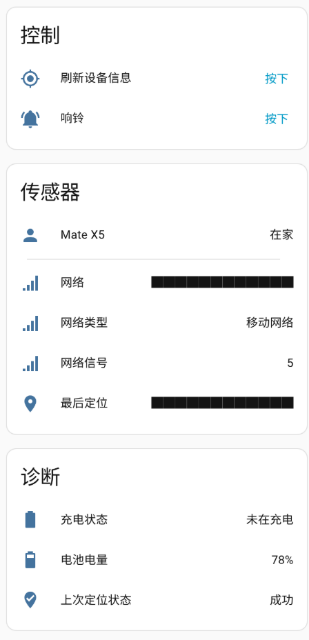
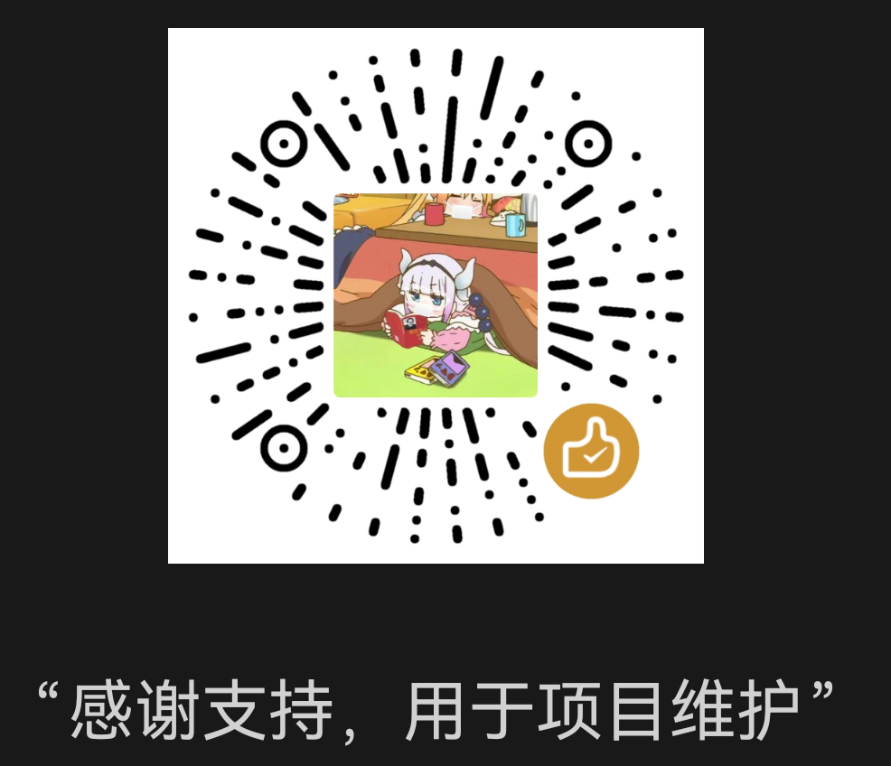
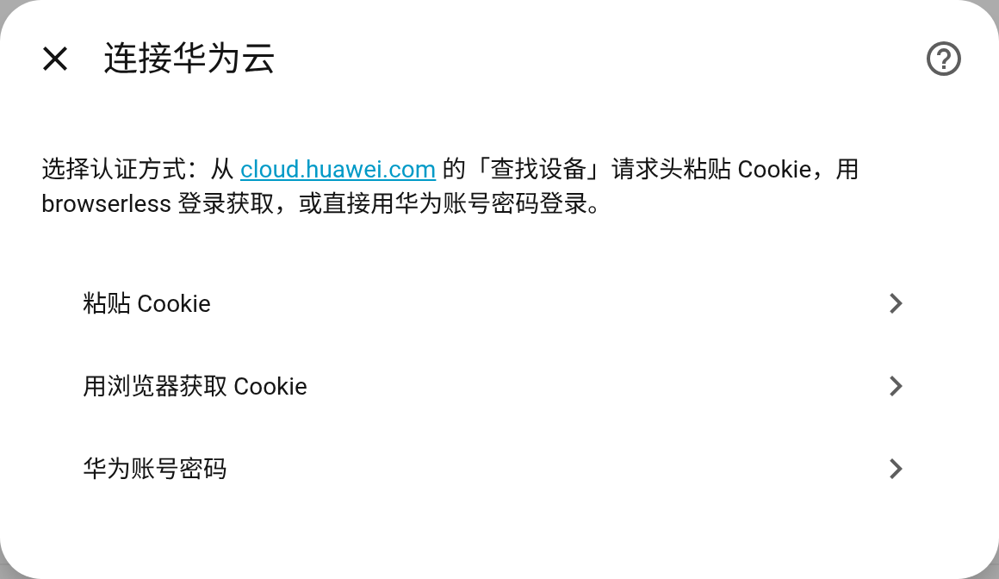

# Huawei Cloud Find Device

[](https://github.com/hacs/integration)
[](LICENSE)

把华为云空间「查找设备」接入 Home Assistant：**点一个按钮，让设备立刻上报一次位置、电量与状态**，
找回设备时还能让它响铃；手表/手环/Tag/耳机还可停止响铃（手机无远程停止）。

Trigger a Huawei Cloud *Find Device* query from Home Assistant — refresh a device's location,
battery and status on demand, or make the phone ring.

> 非官方集成，依赖华为云网页版，接口调整可能导致失效。请仅用于自己或已授权的家人设备。  
> Unofficial integration built on the Huawei Cloud web portal. It may break if Huawei
> changes it. Use it only for devices you own or are authorized to track.

<p align="center">
  
</p>

<p align="center">
  <a href="assets/about/wechat-reward-2026-11.png"></a>
  <br>
  <sub><strong>微信赞赏码</strong> · 如果这个项目帮到你，欢迎支持维护<br>
  赞赏完全自愿，不影响安装、使用或问题反馈。<br>
  WeChat support QR · tips are voluntary and never affect usage or support.</sub>
</p>

---

## 中文说明

### 为什么需要它

华为手机装 Home Assistant Companion App 后，定位经常因为省电策略而延迟。
在华为云网页上点一次「查找设备 → 定位」，会唤醒手机侧定位服务，随后 Companion App
也会跟着更新。本集成把这一步自动化成按钮，并直接读取华为云返回的位置。

### 功能

**定位与追踪**

- 一个「刷新全部设备信息」按钮 + 每台设备一个「刷新设备信息」按钮，自有设备和家人共享设备都支持；
- 定位传感器显示地址；配置了地址源后不再显示经纬度，反查失败时显示「地址解析失败」，坐标仍保留在属性里；
- 每台设备一个 GPS 追踪器，可绑定到 `person`，在原生地图显示；
- 电量、充电状态、上次定位状态各自独立成实体；
- 自有手机额外提供网络名、网络类型（Wi-Fi/移动网络）和信号格数（Wi-Fi 0–4、移动网络 0–5）传感器；手机号不落库、不建实体；
- 单次定位失败不会清空位置：沿用上次结果并标记为「过期」，HA 重启后也保留；
- HA 设备页展示华为返回的型号、固件版本、序列号；接口不提供 MAC，不会伪造；
- 在界面上禁用的设备会被自动跳过，不再无谓唤醒；
- 配置完成后可随时在「配置」页面增删要跟踪的设备，被移除设备的实体与设备条目会自动清理。

**找回手机**

- 自有手机、手表、手环、HUAWEI Tag，以及带 `bell` 能力的耳机（如 FreeBuds Lipstick）各一个「响铃」按钮，触发最大音量警报，30 秒冷却，推送失败会自动重试一次；
- 手表、手环、Tag 和带 `bell` 的耳机另有「停止响铃」按钮，调用 `portalStopBellReq`，不占 30 秒冷却；**手机没有远程停止入口**，不建该按钮；
- 只对本账号自己的设备有效：家人共享的设备不支持。

**自动化与维护**

- 自动刷新间隔（新添加的账号默认 15 分钟），到点查询全部设备；
- 地址反查支持多种来源，默认自动降级（华为 → 高德 → OSM）；切换来源后已有坐标立即重新解析，不会唤醒手机；
- 所有选项修改后立即生效，不需要重启或重载集成；
- 会话状态可在「刷新全部设备信息」按钮属性里查看，失效时会弹通知引导重新授权；
- 集成详情页支持 HA 原生「下载诊断」：会话/设备/最近定位结果脱敏导出，方便报障；
- 可选：Cookie 失效时用 browserless 无头浏览器自动重登并写回新 Cookie（验证码/短信仍需人工）；配置页里这些项收在一个「自动重登（可选增强）」折叠分组；多账号下每个条目独立配置，写回前会校验 Cookie 归属，防止串号；
- 同一位置短时间内不会重复做地址反查。

**多账号**

- 可以添加多个华为账号，各自独立，设备、刷新、保活互不影响。

### 安装

**HACS（自定义仓库）**

1. HACS → 集成 → 右上角 ⋮ → 自定义存储库；
2. 地址填 `https://github.com/hotkong/ha-huawei-find-device`，类别选「Integration」；
3. 安装后重启 Home Assistant。

**手动**

把 `custom_components/huawei_find` 复制到 HA 配置目录的 `custom_components/` 下，重启。

要求：Home Assistant **2026.11+**（实测 2026.11.2），纯 Python，无额外依赖。

### 配置

1. 电脑浏览器登录 <https://cloud.huawei.com/>，打开「查找设备」并点一次定位；
2. 按 `F12` → **Network**，过滤 `locate`；
3. 右键任意请求 → **Copy → Copy request headers**，找到 `Cookie:` 那一行；
4. 回到 HA：设置 → 设备与服务 → 添加集成 → **Huawei Cloud Find Device**，粘贴 Cookie；
5. 勾选要跟踪的设备，提交。

<p align="center">
  
</p>

> 必须从请求头复制：浏览器控制台里的 `document.cookie` 拿不到登录态的完整信息。

> 不想手动复制？添加集成时先三选一：「粘贴 Cookie」「用浏览器获取 Cookie」或「华为账号密码」。
> 「华为账号密码」由集成自己完成登录（纯 Python，不需要 browserless、不需要任何外部服务），
> 密码只在登录流程中使用、**不写入 entry**；手机号绑定了多个华为 ID 时会多一步让你选择。
> 选「用浏览器获取 Cookie」则要填 browserless 地址与华为账号密码，提交后会登录并把 Cookie 预填到确认页。
> 重新授权时三种入口都有。
>
> **账号登录的设备身份**：账号网关只给已注册的设备发完整会话。集成在首次登录时为这一个安装注册一个设备——
> 指纹里不带设备 id 时华为会分配一个新的；拿到的 id 存进条目，后续每次登录和重新授权都复用。
> 没有任何硬编码常量，也不在不同安装之间共用；万一华为不再认这个 id（或条目里的 id 损坏），
> 本次手动登录会自动重新注册一台设备并继续，不需要用户理解或勾选任何选项。
> 邮箱账号走同一套流程，但目前只在手机号账号上做过真机验证。
>
> **风险**：用账号登录可能让该账号在别处的会话失效（包括你正在用的浏览器）。华为可能要求二次验证码，
> 短时间内反复尝试会触发风控——集成在第三次之后会本地拒绝 15 分钟；如果华为那边仍然拒绝，请等更久而不是重试。
> 因此「账号密码登录」适合能接受这些代价的场景，要求绝对稳定时仍建议粘贴 Cookie。
>
> 认证失败时 HA 会提示重新验证，里面有三个入口：**粘贴新 Cookie** / **用浏览器获取 Cookie** / **华为账号密码**；进入后按对应表单操作即可。目前没有常驻的「重新授权」按钮或菜单项（健康条目的三点菜单不提供 Re-auth）。

> **让 Cookie 更耐用的实测经验**：用**无痕窗口**打开 <https://cloud.huawei.com/> 登录并提取 Cookie，
> **提取完尽快关闭无痕窗口**；之后不要在普通窗口再登录同一个华为账号，避免两边会话互相轮换、
> 把 HA 里的 Cookie 顶掉。配合 10–20 分钟的自动刷新，Cookie 通常能稳定使用很久
> （实测远超默认的 6 天提醒线）。关闭无痕窗口只是清掉本地 Cookie，不会主动登出服务端会话。

需要第二个账号时，重复第 1–5 步即可（详见下文「多账号」）。

### 实体与属性

实体 ID 会随界面语言、设备名、账号数量不同而不同，这里只列类型：

| 实体 | 说明 |
|---|---|
| `button.<account>_refresh_all_device_info` | 刷新全部设备信息（跳过已禁用设备；老装置仍为 `_refresh_all_locations`） |
| `button.<device>_refresh_device_info` | 单台设备刷新设备信息（老装置仍为 `_refresh_location`） |
| `button.<device>_ring` | 让设备响铃（手机/手表/手环/Tag/带 `bell` 的耳机；30 秒冷却） |
| `button.<device>_stop_ring` | 停止响铃（仅手表/手环、Tag、带 `bell` 的耳机；手机无此项） |
| `sensor.<device>_last_location` | 状态 = 地址；未配置地址源时才是 `纬度, 经度` |
| `sensor.<device>_battery` | 电量（诊断类）；耳机为“最低电量”，取各组件最低值；Tag 同样可用 |
| `sensor.<device>_left_earbud_battery` | 左耳电量（仅耳机；属性 `reported_at`、`stale`、`connect_type`） |
| `sensor.<device>_right_earbud_battery` | 右耳电量（仅耳机） |
| `sensor.<device>_charging_case_battery` | 充电盒电量（仅耳机且设备上报过充电盒；未上报时为 `unknown`） |
| `binary_sensor.<device>_charging` | 充电状态（仅手机；手表/手环无此实体） |
| `sensor.<device>_network` | 网络名（Wi-Fi SSID 或移动网络名；仅自有手机） |
| `sensor.<device>_network_type` | 网络类型：Wi-Fi / 移动网络（仅自有手机） |
| `sensor.<device>_network_signal` | 信号格数（Wi-Fi 0–4、移动网络 0–5；仅自有手机；属性含最大值与 stale） |
| `sensor.<device>_last_locate_status` | 上次定位状态：成功 / 过期 / 未知（诊断类） |
| `device_tracker.<device>` | GPS 追踪器，可绑定 `person` |
| 服务 `huawei_find.refresh` | 不传 `device_id` 时刷新全部设备；传 HA 设备 ID 只刷新该设备；等请求完成才返回 |
| 服务 `huawei_find.set_cookie` | 直接更新会话 Cookie，无需操作界面（多账号时从账号下拉选择） |
| 服务 `huawei_find.refresh_cookie` | browserless 登录 → 校验新 Cookie → 成功才写回；返回长度/账号尾号/设备数，失败带原因 |

「刷新全部设备信息」按钮的属性：设备数、启用中的设备数、正在刷新的设备、各设备最近状态、当前 Cookie 已使用天数、最近一次会话保活是否成功及时间、累计保活失败次数。

定位传感器的属性：`latitude`、`longitude`、`accuracy`、`coordinate_system`、`address`、`address_stale`、`device_time`、`result_time`、`result_stale`、`located_at`、`last_attempt`、`status`、`last_error`。电池属性里的 `reported_at`/`stale` 用来判断电量是否为云端缓存的旧值（`exeResult=900` 或超过 6 小时）。

### 配置项

设置 → 设备与服务 → Huawei Cloud Find Device → **配置**：

| 选项 | 说明 |
|---|---|
| 地址来源 | `Auto`（推荐，华为 → 高德 → OSM 依次降级）/ `Huawei Map`（免 Key）/ `AMap / Gaode`（需 [高德开放平台](https://lbs.amap.com/) Key）/ `OpenStreetMap`（免 Key）/ `Disabled`（只用坐标） |
| 高德 Key | 仅选择高德时需要 |
| 自动刷新间隔 | 分钟，`0` = 关闭；**默认 15**；最大 720 |
| 无头浏览器地址 | 可选，如 `http://192.168.1.100:3000`（browserless v2，`/pressure` 可访问） |
| Browserless 令牌 | 可选，实例启用 token 时填写 |
| 华为账号 / 密码 | 可选，仅用于 Cookie 失效时自动重登；**明文保存在 HA `.storage`** |

> **建议把自动刷新间隔设为 10–20 分钟，不要超过 20 分钟。**  
> 华为云会话会因长时间没有新请求而失效，间隔过大时更容易掉线；失效后需要重新粘贴 Cookie。

修改选项后立即生效，不会让实体短暂变成不可用。

### 自动化示例

```yaml
alias: 华为云定位定时刷新
triggers:
  - trigger: time_pattern
    minutes: /15
conditions:
  - condition: time
    after: "06:00:00"
    before: "22:30:00"
actions:
  - action: button.press
    target:
      entity_id: button.huawei_cloud_find_device_refresh_all_device_info
mode: single
```

实体 ID 请以你系统里的实际值为准；配置了多个账号时，后添加的条目实体 ID 会带 `_2`、`_3` 后缀。

若使用这条自动化，请把集成里的自动刷新间隔设为 `0`（新添加的账号默认是 15），否则会重复唤醒手机。

### 禁用 vs 隐藏

- **禁用**设备/实体：不再加载，且「刷新全部设备信息」会跳过它，不产生请求；
- **隐藏**：只是不在仪表盘显示，仍然正常刷新。

### 多账号

1. 再执行一次「设置 → 设备与服务 → 添加集成 → Huawei Cloud Find Device」；
2. 粘贴另一个账号的 Cookie；
3. 勾选要跟踪的设备（列表里会标注 `own` / `shared`，多账号时建议只选需要的那几台，避免重复实体）。

账号之间完全独立，条目名称会带账号尾号以便区分（如 `Huawei Cloud Find Device (5311)`）。

调用 `huawei_find.set_cookie` 时，如果配置了多个账号，需要额外指定目标账号，避免写错。

<a id="auto-relogin"></a>
### 自动重登（可选）

Cookie 仍是主认证。会话失效时可选用 browserless 无头登录自动换一份新 Cookie：

1. 部署一个 browserless v2（`GET /pressure` 返回 200），HA 能访问到；
2. 配置里填「无头浏览器地址」；实例启用 token 时再填 token；
3. 填华为账号/密码（明文保存在 HA `.storage`，请评估风险）；
4. 失效时自动用无头浏览器登录；遇到图形/短信验证码仍需人工贴 Cookie。

成功后写回新 Cookie，并清掉通知与残留的“重新验证”流程。

### 会话与重新授权

- 华为云会话会过期，**具体期限不固定**，取决于华为侧的策略和你的使用频率；
- 集成会自动保持会话活跃，并在失效时弹通知，点「重新验证」粘贴新 Cookie 即可；
- 「刷新全部设备信息」按钮的属性可以看到会话是否正常、已经使用了多少天；
- Cookie 使用较长时间后会提醒你提前更新；
- 也可以用 `huawei_find.set_cookie` 服务直接更新，不必进入界面。

### 已知限制

- 响铃支持本账号自己的手机/手表/手环，以及带 `bell` 能力的耳机（如 FreeBuds Lipstick）；家人共享的设备不支持；
- 手表/手环也能定位，但需要设备在线；离线时查询会返回「设备不活跃」；
- 返回的坐标可能是云端缓存，无法区分「刚刚上报」与「上次缓存」；
- 地址反查依赖第三方服务，偶发超时会沿用上次地址并标记为已过期；
- 华为云会话失效后默认需手动更新 Cookie；配置了浏览器自动重登才可能自动恢复，遇到验证码/短信仍需人工。
- 启用浏览器登录会把华为账号密码明文存进 HA 的 `.storage`，请自行评估风险。

### Roadmap

- [x] 按钮触发 / 定位传感器 / GPS 追踪器
- [x] 地址反查（自动降级：华为 → 高德 → OSM）
- [x] 自动刷新间隔
- [x] 失败保留最后坐标、跳过禁用设备
- [x] 会话保活、失效提醒、提前提醒更新
- [x] 响铃按钮（自有手机/手表/手环 + 带 `bell` 能力的耳机）
- [x] 多账号支持
- [x] 选项即时生效、切换地址源立即重新解析
- [ ] 自动刷新的时间窗（晚间不查询）
- [ ] 设备列表热更新（不重载集成）
- [x] 诊断信息导出（自动脱敏）

---

## English

### Why

The HA Companion app often reports stale locations on Huawei phones because of
aggressive battery management. Querying *Find Device* on the Huawei Cloud portal wakes
the phone's location service. This integration turns that into a HA button and reads the
resulting position.

### Features

**Location and tracking**

- One "refresh all device info" button plus a per-device "refresh device info" button (own and shared devices);
- Address sensor (coordinates only when no address source is configured);
- GPS `device_tracker` per device, ready to attach to a `person`;
- Separate battery, charging and last-locate-status entities; earbuds report left bud, right bud and charging case batteries separately, plus a lowest-battery aggregate;
- Own phones also expose the network name (Wi-Fi SSID or mobile network), the network type and signal bars (Wi-Fi 0–4, mobile 0–5); the phone number is never stored;
- The device page shows the model, firmware version and serial number reported by Huawei (the API has no MAC, so none is invented);
- Failed lookups keep the last known position (marked stale), and results survive restarts;
- Devices disabled in the UI are skipped automatically;
- Tracked devices can be added or removed later from the Options page, with entities and device entries cleaned up.

**Finding a phone**

- A "ring device" button per own phone, watch, band, HUAWEI Tag or `bell`-capable earbuds (max-volume alarm, 30 s cooldown, one automatic retry);
- Watches, bands, Tags and `bell` earbuds also get a "stop ringing" button; the web portal offers no remote stop for phones, so none is created;
- Own devices only — family-shared devices are not supported.

**Automation and maintenance**

- Optional auto refresh interval;
- Address lookup with automatic fallback (Huawei → AMap → OSM); switching sources re-resolves
  known coordinates immediately without waking the phone;
- Option changes apply instantly, no restart or reload;
- Session status visible on the "refresh all device info" button, with a re-auth notification when it expires;
- Native "Download diagnostics" on the integration page: a redacted export of the session, devices and recent lookup results;
- Optional: an expired cookie can be renewed by a headless login through browserless, or by signing in with the Huawei account (verification codes still need manual action);
- Repeated lookups of the same position are not re-resolved.

**Multiple accounts**

- Add several Huawei accounts; devices, refreshes and session handling stay isolated.

### Installation

HACS → Integrations → ⋮ → Custom repositories → add this repo URL, category
*Integration*. Or copy `custom_components/huawei_find` into your HA config and restart.

Requirements: Home Assistant **2026.11+** (tested on 2026.11.2), no extra dependencies.

### Configuration

Copy the `Cookie` request header (DevTools → Network → any find-device request) and paste
it into the integration setup, then pick the devices to track. Repeat for a second account.

Don't want to copy it by hand? Setup offers three sign-in paths: paste a `Cookie`, let the
integration fetch one through a browserless instance, or sign in with the Huawei account and
password (pure Python, no browserless needed — the password is used only for that login and
is **not written to the entry**). Re-authentication offers the same three paths. Account
login may invalidate other sessions of that account and can trigger a verification code, and
repeated attempts are rate-limited locally after three failures; paste a cookie if you need
maximum stability. The device identity used for account login is registered once per
installation and reused afterwards — if Huawei stops accepting it, the next manual login
re-registers automatically.

> **Tip for a longer-lived cookie (tested)**: sign in from a **private/incognito window**,
> copy the `Cookie` header, then **close the incognito window right away**. Don't sign into
> the same Huawei account in a normal window afterwards — the two sessions rotate each
> other's cookies and can invalidate the one HA is using. With a 10–20 minute refresh
> interval the cookie usually stays valid far beyond the 6-day reminder.

### Entities

`button.*_refresh_all_device_info`, `button.*_refresh_device_info` (older installs keep `_refresh_all_locations` / `_refresh_location`), `button.*_ring`, `button.*_stop_ring`
(watches/bands/Tags and `bell` earbuds only), `sensor.*_last_location`, `sensor.*_battery`,
earbud battery sensors per component, `sensor.*_network*` (own phones only),
`binary_sensor.*_charging` (phones only), `sensor.*_last_locate_status`, `device_tracker.*`,
plus the `huawei_find.refresh`, `huawei_find.set_cookie` and `huawei_find.refresh_cookie` services.

### Recommended settings

Set the auto refresh interval to **10–20 minutes, not more than 20**. The Huawei Cloud
session can expire when no new requests are made for a long time, so a longer interval
makes it more likely to lose the session (and require pasting a new cookie).

### Known limitations

- Ringing only works for your own phones, watches, bands, Tags and `bell` earbuds, not for shared ones;
- Watches/bands can be located too when online; offline ones report "device inactive";
- Returned coordinates may come from Huawei's cache;
- Address lookup is best effort and falls back to the previous address;
- Session lifetime is not fixed; without the optional browserless/account login you must paste
  a new cookie when it expires;
- Browser login stores the Huawei password in plain text in HA's `.storage` — opt in only if
  you accept that.

## License

[MIT](LICENSE)
